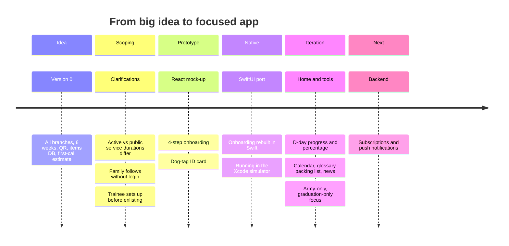
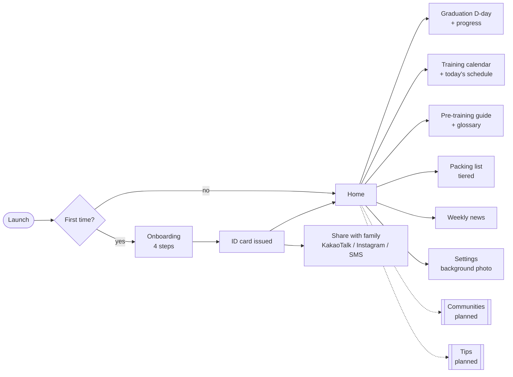
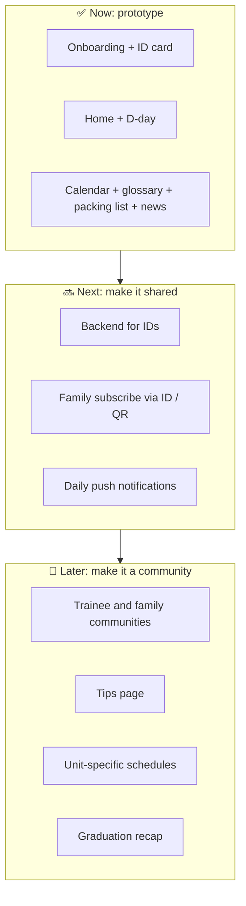

# 🪖 Dogtag Days

**A SwiftUI companion app for Korean Army basic training, built around one idea:**
**the app lives only until graduation day.**

---

## 💡 The Idea

The first five weeks of basic training are the most confusing stretch for both sides.

- The **trainee** hands in their phone on day one and disappears from the digital world.
- The **family and friends** are left refreshing blogs, forums and cafe posts, trying to guess what he is doing right now.

Everyone ends up with the same questions:

> *What is he doing today? When can he call? What can I send? How many days are left?*

**Dogtag Days** answers those questions in one place. It is not a general military app and it does not count down to discharge. It counts down to the one day that matters in this window: **graduation day (수료식)**.

### Core principles

| | Principle | What it means |
|---|---|---|
| 🎯 | **Graduation-only** | Everything is built around the 5 weeks of basic training. 35 days for active duty, 21 days for public service. When graduation passes, the app's job is done. |
| 🪖 | **Army-only** | One branch, done well, instead of three done vaguely. |
| 👨‍👩‍👧 | **Family-first** | The trainee sets things up *before* enlisting. After that, the family and friends follow along. |
| 🔕 | **Zero effort inside** | The trainee has no phone, so nothing in the app needs daily input. Everything is calculated from the enlistment date. |
| 😄 | **Friendly tone** | Military jargon explained with humor, not a stiff manual. |
| 🔓 | **No login** | Family and friends follow with an ID or QR code. Read-only. No accounts, no passwords. |

---

## 🧬 How the Idea Evolved

This project did not start as it looks today. The first version was much bigger. Cutting it down was most of the design work.

### Version 0: the big idea

> *"An app for every Korean enlistee, focused on the 6-week training camp."*

The original plan had four pillars:

1. **Onboarding survey** that generates a unique ID and QR code for family and friends
2. **Weekly training info** with a mix of emotional and informational text
3. **Visualizations** such as "time until graduation" and "time until the first phone call"
4. **Allowed-items database** with a checklist, possibly crowdsourced

The first prototype was a React mock-up with four onboarding steps: basic info, **branch (육군 / 해군 / 공군)**, service status, and a review screen that issued an ID such as `AR-1234`, `NV-1234` or `AF-1234`.

### What changed, and why

| # | Question we hit | Early idea | What we decided | Why |
|---|---|---|---|---|
| 1 | Who is the real user? | Trainees use the app | **Family and friends** use it; the trainee only sets it up | Trainees have no phones inside. |
| 2 | How do family "subscribe"? | Create an account | **ID or QR, no login** | Fewer steps means more people actually follow along. |
| 3 | Which branches? | Army, Navy, Air Force | **Army only** | Schedules differ a lot by branch. Three half-correct calendars are worse than one good one. |
| 4 | How long is "training"? | 6 weeks for everyone | **35 days (active duty) / 21 days (public service)** | The durations genuinely differ by service status. |
| 5 | What are we counting down to? | Discharge, or the whole service | **Graduation day only** | A 18-month countdown is demoralizing. Five weeks feels reachable. |
| 6 | "First phone call" estimate | A dedicated prediction feature | **Dropped for now** | The timing is not fixed and varies by unit, so any number would be a guess presented as fact. |
| 7 | Allowed-items database | Big crowdsourced DB | **Curated, tiered packing list** | A short list people actually read beats a huge database nobody trusts. |
| 8 | When is the enlistment date known? | Required at signup | **Optional**, filled in later | Many people sign up before they know the date. |
| 9 | Notifications | Per-branch master schedule DB | **Deferred**; local schedule from the date for now | The master database is a big job. Ship the visible parts first. |
| 10 | Tone | Neutral and informative | **Playful, with humor** | The audience is anxious. A smile helps. |

### Timeline



---

## ✨ Features

### Built so far

- [x] **Onboarding flow**: name, age, birth date, active duty or public service, optional enlistment date
- [x] **Dog-tag ID card**: a generated ID (`AR-XXXX`) styled like a military dog tag
- [x] **Sharing**: KakaoTalk, Instagram, SMS and the system share sheet
- [x] **Graduation tracker**: D-day count, progress percentage and a filling progress bar
- [x] **Today's schedule**: "오늘 M월 d일 (E) 일정은 … 입니다", computed from the enlistment date
- [x] **5-week training calendar**: a 5 × 7 grid with an emoji and short label on every day, today highlighted
- [x] **Military glossary**: 8 terms explained with humor (생활관, 군번줄, 오버로크, 싸제, 암구호, 호봉, 제식훈련, 정신전력교육)
- [x] **Tiered packing list**: Tier 1 must-haves, Tier 2 nice-to-haves, what is provided, and key points, all as emoji cards
- [x] **Weekly news**: 10 headlines from the last 7 days with thumbnails, opening in the browser
- [x] **Settings**: custom home background, for example a family or couple photo

### Planned

- [ ] Family and friend subscription by ID or QR code (read-only, no login)
- [ ] Daily push notifications for subscribers
- [ ] Trainee, family and friends communities
- [ ] Training camp tips page
- [ ] Per-unit schedule customization
- [ ] Birthday reminders (the birth date is already collected)
- [ ] Graduation recap: a "look back at 5 weeks" view for after the ceremony

---

## 📱 Screens

A rough sketch of the main flow. The real screens use olive and clay tones on a warm paper background.

<table>
<tr>
<td align="center" width="25%">

**1. Onboarding**

```
┌──────────────────┐
│ ▬▬▬▬ ▬▬▬▬ ▬ ▬    │
│                  │
│ 훈련병 정보 등록  │
│                  │
│ NAME             │
│ [ 홍길동       ] │
│ AGE              │
│ [ 21           ] │
│ BIRTH            │
│ [ 2005.01.01   ] │
│                  │
│ [    다음  →   ] │
└──────────────────┘
```

</td>
<td align="center" width="25%">

**2. Dog-tag ID**

```
┌──────────────────┐
│ ┌──────────────┐ │
│ │ TRAINEE      │ │
│ │ 홍길동        │ │
│ │ 육군 · 21세   │ │
│ │              │ │
│ │ AR-4821      │ │
│ └──────────────┘ │
│                  │
│ [KakaoTalk]      │
│ [Instagram]      │
│ [SMS] [More]     │
└──────────────────┘
```

</td>
<td align="center" width="25%">

**3. Home**

```
┌──────────────────┐
│ 🎖️ 5주만 함께해요 │
│                  │
│   D-21           │
│   40% ▓▓▓▓░░░░░░ │
│                  │
│ 📅 훈련 스케줄    │
│ 📖 미리 알아보기  │
│ 📰 이번주 뉴스    │
│ 🎒 준비물         │
│ ⚙️ 설정          │
└──────────────────┘
```

</td>
<td align="center" width="25%">

**4. Calendar**

```
┌──────────────────┐
│ 오늘 일정은       │
│ 제식훈련입니다    │
│                  │
│ W1 🚶 🚶 🎯 🧹 📚 │
│ W2 🔫 🔫 🔫 📖 🧪 │
│ W3 🏃 🏃 ⛺ ⛺ 🧠 │
│ W4 🏹 🏹 🏹 ...   │
│ W5 🎓 ...        │
└──────────────────┘
```

</td>
</tr>
</table>

### Screen map



---

## 🧭 Design Decisions

### Who actually uses the app?
Trainees hand in their phones on day one. So the real flow is: the trainee sets up before enlisting, then the family keeps looking at the app. That is why data flows **one way** and updates **automatically** from the enlistment date, with no daily input.

### Why only up to graduation?
A narrow scope makes every screen more useful. D-day, schedule, tips and packing list all answer the same question: *"What is happening right now, and what comes next?"* After graduation that question changes, and so does the app's job.

### Why a tiered packing list?
A flat list of 30 items is overwhelming. Tiers answer "what happens if I forget this?", and the closing key points remind everyone that **most things are provided anyway**, the PX is open on weekends, and parcels are allowed after entry.

| Tier | Meaning | Examples |
|---|---|---|
| 🥇 **Tier 1** | Worth bringing | Earplugs, digital watch, toiletries, all-in-one charging cable |
| 🥈 **Tier 2** | Nice to have | Wired earphones, knee and elbow guards, shoulder pads, tumbler |
| 📦 **Provided** | Do not bother | Laundry net, detergent, first-aid medicine |

### Why a playful tone?
The people reading this are nervous parents, partners and friends. Terms like *오버로크* or *암구호* sound intimidating until someone explains them in one funny sentence. Humor lowers the anxiety, and the facts still stay accurate.

### Design language

| Token | Color | Use |
|---|---|---|
| `bg` | `#F5F3ED` | Warm paper background |
| `ink` | `#262521` | Primary text, dog-tag card |
| `inkSoft` | `#5A5648` | Secondary text |
| `olive` | `#707C5C` | Primary accent |
| `oliveDark` | `#565F45` | Buttons, headers |
| `clay` | `#B5624B` | Highlights, today marker, ID number |
| `line` | `#D9D4C7` | Borders, dividers |

Olive and clay give a calm military feel without being harsh. Monospaced type is used for the dog-tag ID, and emoji carry the friendly tone.

---

## 🛠️ Development Process

```mermaid
gantt
    title Build journey
    dateFormat  X
    axisFormat  %s
    section Plan
    Idea and feature scoping        :done, a1, 0, 2
    Trim to Army-only, graduation-only :done, a2, 2, 4
    section Prototype
    React onboarding mock-up        :done, b1, 4, 6
    section Native
    SwiftUI port                    :done, c1, 6, 8
    Xcode simulator and bug fixing  :done, c2, 8, 11
    section Features
    Home, D-day, settings           :done, d1, 11, 13
    Calendar, glossary, packing list, news :done, d2, 13, 16
    section Ship
    Real iPhone testing             :active, e1, 16, 18
    Backend for subscriptions       :e2, 18, 22
```



1. **Idea and scoping.** Defined the core features, then deliberately trimmed to Army-only and graduation-only.
2. **React prototype.** Sketched onboarding and the ID card as a fast visual prototype.
3. **SwiftUI port.** Rebuilt onboarding in SwiftUI and ran it in the Xcode simulator.
4. **Iteration.** Added the home screen, D-day progress, settings, news, glossary, calendar and packing list, fixing bugs along the way.
5. **Real-device testing.** Signing and running on an iPhone.
6. **Next.** Backend for subscriptions and notifications.

<details>
<summary><b>🐛 Bugs we hit along the way (click to expand)</b></summary>

<br/>

| Problem | Cause | Fix |
|---|---|---|
| `keyboardType` errors on build | Project was created as a macOS app | Recreate as **iOS App (SwiftUI)**, and wrap `.keyboardType` in `#if os(iOS)` |
| `Ambiguous use of 'init()'` | Two copies of the same file in the project | Keep one copy, clean the build |
| Preview paused or cannot preview | Heavy single-file project | Run on the simulator instead of the canvas |
| Xcode hangs on "Attaching" | Low memory | Quit heavy apps, Clean Build Folder (`⌘⇧K`), run again |
| Simulator not responding to taps | Debugger paused | Resume, deactivate breakpoints (`⌘Y`), restart the device |
| Korean letters split (ㅎㅗㅇㄱ) | iOS 17.2 simulator IME bug | Use the on-screen keyboard or paste, and it behaves on a real device |
| Install on iPhone failed | No development team set | Set a **Team** under Signing and Capabilities, then trust the developer on the phone |

</details>

---

## 🧱 Tech Stack

| Area | Tool |
|---|---|
| UI | SwiftUI (`NavigationStack`, `LazyVGrid`, `GeometryReader`) |
| Photos | PhotosUI (`PhotosPicker`) |
| Local storage | `@AppStorage` (home background) |
| Images | `AsyncImage` for news thumbnails |
| News | Google News RSS parsed with `XMLParser`, thumbnails from each article's `og:image` |
| Sharing | URL schemes (`kakaotalk://`, `instagram://`, `sms:`) and `UIActivityViewController` |
| IDE | Xcode |
| Prototype | React (early mock-up only) |

```
Dogtag-Days/
├── 📄 README.md
├── 📱 훈련소 도우미.xcodeproj
└── 📁 훈련소 도우미/
    ├── ContentView.swift      ← app UI
    ├── _App.swift             ← entry point
    └── Assets.xcassets
```

The whole app currently lives in a single SwiftUI file to keep copy and paste into Xcode simple. Splitting it into `Models/`, `Views/` and `Services/` is on the roadmap.

---

## 🗺️ Roadmap



| Stage | Goal | Blocker |
|---|---|---|
| **Now** | Everything works offline on one device | Needs real-device verification |
| **Next** | Family can actually follow along | Needs a backend and Apple Developer Program for push |
| **Later** | A small community around the 5 weeks | Moderation, and a reliable schedule source |

---

## 🚀 Getting Started

### Requirements
- A Mac with **Xcode** installed
- iOS 17 or later simulator, or an iPhone

### Run it

```bash
git clone https://github.com/KIMMINKWN/Dogtag-Days-.git
cd Dogtag-Days-
open "훈련소 도우미.xcodeproj"
```

1. Choose an **iPhone simulator**, or your own device after setting a **Team** under *Signing and Capabilities*.
2. Press **Run** (▶).
3. On a real device, trust the developer under *Settings → General → VPN and Device Management*.

> 💡 The news screen needs an internet connection.
> 💡 A free Personal Team build expires after 7 days. App Store release needs the paid Apple Developer Program.

---

## ❓ FAQ

<details>
<summary><b>Is this an official Army app?</b></summary>
<br/>
No. It is an unofficial personal project and is not affiliated with the Republic of Korea Army or the Ministry of National Defense.
</details>

<details>
<summary><b>Is the 35-day schedule accurate?</b></summary>
<br/>
It is a rough reference built from the general flow of Army basic training. It is <b>not an official timetable</b>, and the real schedule can differ by unit and class.
</details>

<details>
<summary><b>Why not Navy and Air Force?</b></summary>
<br/>
Their schedules and durations differ. Doing one branch properly is better than three that are only roughly right.
</details>

<details>
<summary><b>Can the trainee use it inside?</b></summary>
<br/>
No, and that is the point. Phones are handed in on day one. The app is designed for the people waiting outside.
</details>

<details>
<summary><b>What happens after graduation?</b></summary>
<br/>
The countdown ends and the app's job is done. A "look back at 5 weeks" recap is planned as a goodbye screen.
</details>

<details>
<summary><b>Where does the ID come from?</b></summary>
<br/>
For now it is generated on the device. Real family subscription needs a backend that is not built yet.
</details>

---

## ⚠️ Notes

- The training schedule is an approximation, not official information.
- IDs are generated locally. There is no server yet.
- News headlines come from public Google News RSS and open in the browser.
- Nothing personal leaves the device in the current prototype.

---

<div align="center">

### *Five weeks, shared together.* 🪖

Built by [@KIMMINKWN](https://github.com/KIMMINKWN)


</div>
